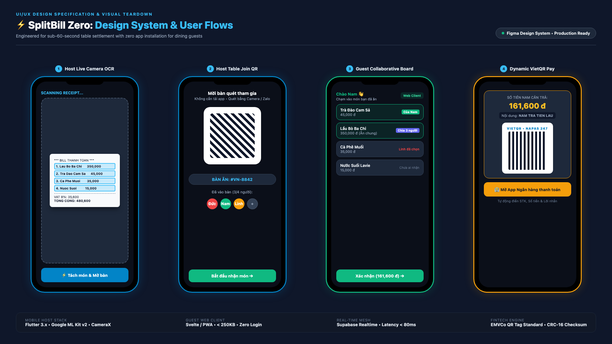
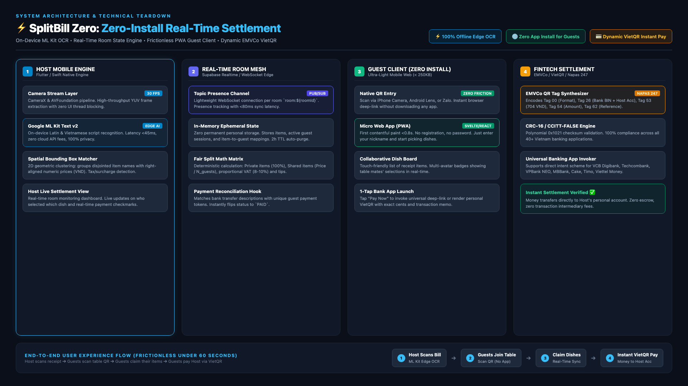
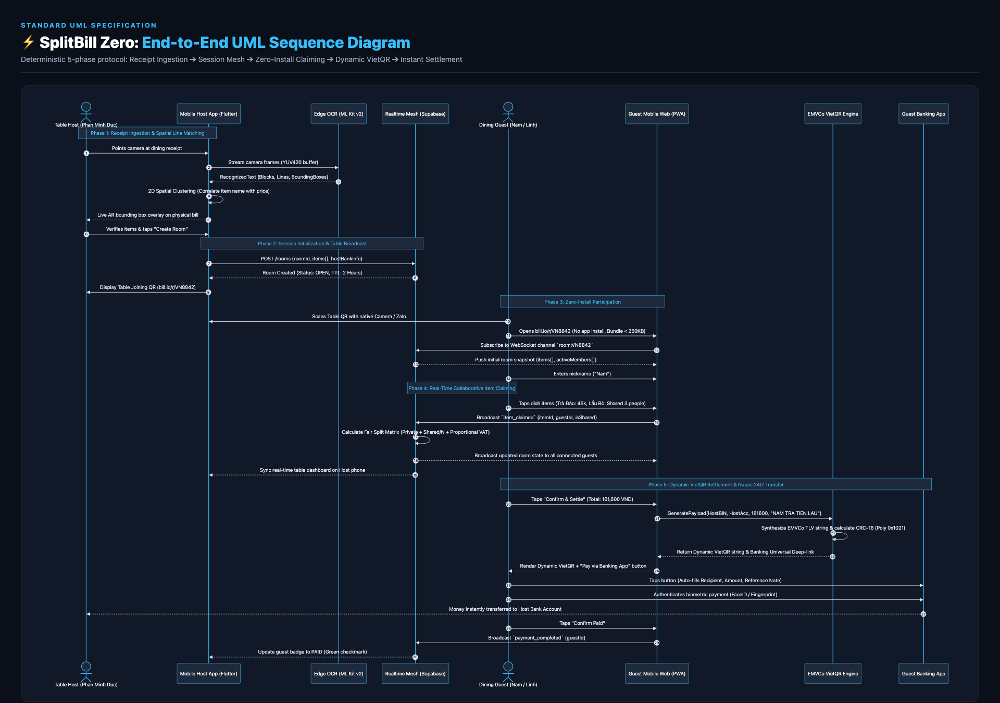
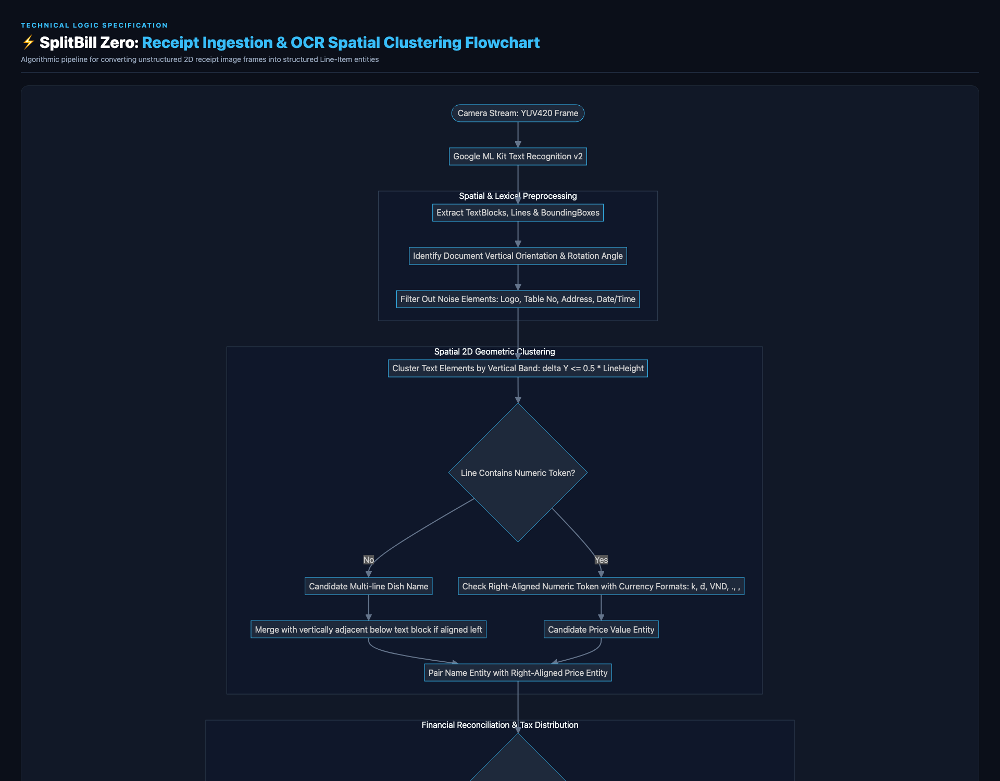

# ⚡ SplitBill Zero (Smart Real-Time Bill Splitter)

[](https://opensource.org/licenses/MIT)
[](https://flutter.dev)
[](https://developers.google.com/ml-kit)
[](https://supabase.com)
[](https://vietqr.net)
[](https://w3.org/TR/appmanifest/)

> **A high-performance, zero-friction dining bill splitter engineered for modern mobile environments.**  
> Solves the fundamental adoption flaw of traditional bill-splitting apps: **Dining guests never have to install an app or register an account.** 

---

## 🎯 The Core Problem & Architectural Breakthrough

| Traditional Bill Splitters (Splitwise, Tab, etc.) | ⚡ SplitBill Zero Architecture |
| :--- | :--- |
| ❌ Forces every dining friend to install an app & create accounts | ✅ **Zero App Install for guests:** Instant participation via native camera QR scan. |
| ❌ Manual line-by-line item typing or clunky cloud OCR | ✅ **On-Device Edge OCR (Google ML Kit v2):** < 45ms parsing latency, 100% offline & zero cloud fees. |
| ❌ Passing a single expensive smartphone around the dinner table | ✅ **Real-Time Mesh Synchronization:** Everyone claims their dishes on their own phone browser. |
| ❌ Manual account number copy-pasting & typing transfer notes | ✅ **Dynamic EMVCo VietQR:** 1-tap launch into 40+ Vietnam banking apps with pre-filled amount & memo. |

---

## 📱 UI/UX Showcase & Live Flow



1. **Host Live Camera OCR:** Live bounding box detection over physical receipt. Geometric clustering pairs dish names with numeric VND prices.
2. **Host Table Join QR:** Generates a real-time table room (e.g., `#VN-8842`). Guests join simply by scanning with native iPhone/Android Camera or Zalo.
3. **Guest Collaborative Board:** Instant mobile web board (< 250KB bundle). Guests tap items to claim them or split shared dishes evenly.
4. **Dynamic VietQR Settlement:** Generates a strictly-compliant EMVCo QR code encoded with the exact individual amount, host bank account, and unique reference note.

---

## 🏗️ System Architecture & Subsystems Specification

The system is architected into 4 decoupled, high-cohesion subsystems adhering to strict clean-architecture boundaries:



*Editable Draw.io source available at: [`docs/SplitBill_Zero_Architecture.drawio`](docs/SplitBill_Zero_Architecture.drawio) (Import into [app.diagrams.net](https://app.diagrams.net))*

### Subsystems Breakdown:
- **Subsystem A (Client Interaction Layer):** Flutter 3.x Host Master Engine & Ultra-lightweight Guest PWA Web Client (< 250KB).
- **Subsystem B (On-Device Ingestion & OCR Engine):** CameraX/AVFoundation streaming buffer, Google ML Kit v2 OCR, 2D Spatial Geometric Clustering ($|\Delta Y| \le 0.5 \times \text{LineHeight}$), and Tax/Surcharge Distributer.
- **Subsystem C (Collaborative Session Mesh):** WebSocket / Supabase Realtime Gateway under topic `room:${roomId}`, in-memory ephemeral store with 2-hour TTL auto-eviction, and Fair-Split Math Matrix.
- **Subsystem D (Banking & Settlement Gateway):** EMVCo QR Tag Synthesizer (NAPAS 247), CRC-16/CCITT-FALSE Checksum Engine (Poly `0x1021`), and Payment Event Reconciliation Listener.

---

## 🔄 End-to-End UML Sequence Diagram

The interaction protocol across the 5 distinct phases from camera ingestion to Napas 24/7 instant settlement:



---

## 🧠 Algorithmic Pipeline: OCR Spatial Clustering & Line Matching

Raw OCR extracts unstructured text blocks scattered in 2D coordinates. SplitBill Zero utilizes a spatial grouping heuristic to reconstruct receipt tabular geometry:



### Mathematical Clustering Formulation:
$$\text{Vertical Closeness Condition:} \quad |Y_{\text{price}} - Y_{\text{item}}| \le \theta_{\text{line\_height}} \times 0.5$$
$$\text{Horizontal Alignment Check:} \quad X_{\text{price}} > X_{\text{item}} \quad (\text{Right-aligned price pattern})$$

---

## 📂 Repository Structure

```tree
splitbill-zero/
├── apps/
│   ├── mobile-host/            # Flutter Mobile App for Table Host (OCR & Camera)
│   └── guest-web/              # Lightweight Mobile Web App for Dining Guests
├── packages/
│   ├── ocr-parser/             # Spatial bounding-box regex & dish matching algorithms
│   ├── realtime-engine/        # Supabase/WebSocket room presence & state sync
│   └── vietqr-engine/          # EMVCo TLV string generator & CRC16 checksum encoder
├── docs/
│   ├── SplitBill_Zero_Architecture.drawio   # Editable enterprise system design diagram
│   ├── SplitBill_Zero_Architecture.png      # High-res architecture export
│   ├── SplitBill_Zero_Sequence_Diagram.png  # Standard UML Sequence Diagram
│   ├── SplitBill_Zero_OCR_Flowchart.png     # Algorithmic spatial matching flowchart
│   └── SplitBill_Zero_UI_Showcase.png       # Production UI/UX spec & design showcase
└── README.md
```

---

## 🚀 Quickstart & Development

### Prerequisites
* Flutter SDK >= 3.22.x
* Node.js >= 20.x
* Docker (for local Supabase edge container)

```bash
# 1. Clone the repository
git clone https://github.com/ducphan1311/splitbill-zero.git
cd splitbill-zero

# 2. Run local real-time mesh
npm install
npm run dev:realtime

# 3. Launch Guest Web Client
cd apps/guest-web
npm run dev

# 4. Run Flutter Mobile Host App
cd apps/mobile-host
flutter pub get
flutter run
```

---

## 👨‍💻 Author & Engineering Leadership

**Phan Minh Duc (Danny)**  
*Senior Mobile Architect & Full-Stack Engineer*  
*Specializing in Flutter, Native iOS/Android, Edge AI, and High-Concurrency Fintech Systems.*

* 🌐 **Portfolio:** [ducphan1311.github.io/portfolio](https://ducphan1311.github.io/portfolio/)
* 💼 **LinkedIn:** [linkedin.com/in/minh-duc-phan-5a3b05228/](https://www.linkedin.com/in/minh-duc-phan-5a3b05228/)
* 🐙 **GitHub:** [github.com/ducphan1311](https://github.com/ducphan1311)

---

## 📄 License

Distributed under the MIT License. See `LICENSE` for more information.
